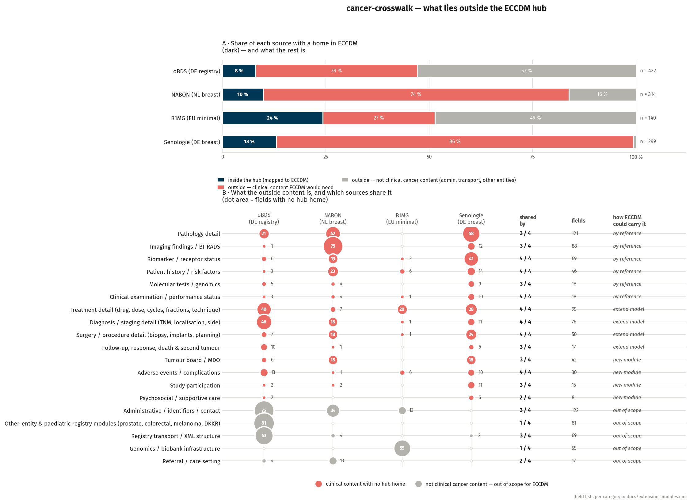
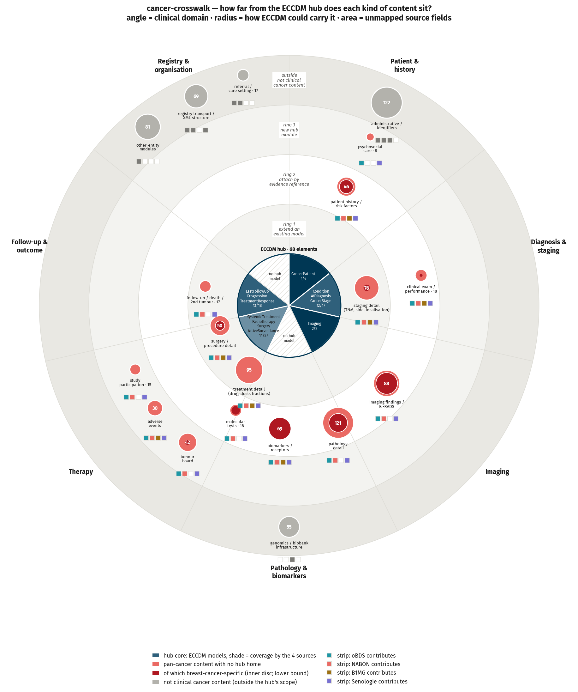
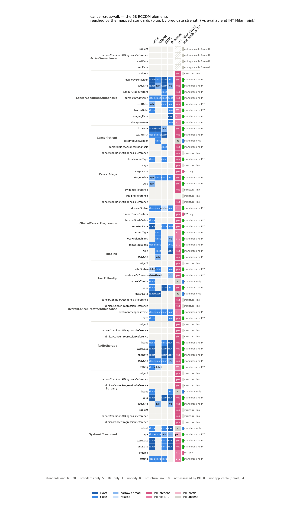

## Executive summary

We compared four cancer datasets against the **HL7 Europe Cancer Common Data
Model (ECCDM)** to answer one question: *if ECCDM is the shared hub, how much of
each dataset does it actually carry, and what is missing?*

Three results stand out:

1. ECCDM covers the **generic cancer backbone well** (63 % of its own elements
   are reached by at least one source) but only **8–24 % of each source
   dataset** — most fields have no hub home.
2. The uncovered fields are overwhelmingly **breast-cancer-specific detail**
   (ER/PR/HER2, BI-RADS, grading detail, molecular tests). ECCDM, being a
   pan-cancer *minimal* model, has no place for them.
3. That missing content is not random. Every unmapped field (1,037 across the
   four sources) is placed in one of 19 named information categories: 14 are
   clinical content ECCDM would need, 5 are out of scope (administrative,
   registry transport, other-entity organ modules, biobank infrastructure).
   The clinical part splits three ways: *data-dictionary* work attached by
   evidence-reference (pathology, imaging, biomarkers, history), *detail on
   models ECCDM already has* (treatment, staging, surgery, follow-up), and a
   few genuinely **new modules** (tumour board, adverse events, study
   participation, psychosocial care).

**Bottom line for a breast-cancer effort:** ECCDM works as a generic *semantic
spine*, but needs breast extension modules attached by evidence-reference. This
report quantifies exactly what those modules must contain.

---

## 1. Why this analysis

European cancer data lives in many national and domain standards. For registries
and EHDS secondary use, they need to be comparable. ECCDM is HL7 Europe's attempt
at a common denominator. Before adopting it as an exchange or aggregation target
— especially for a **breast-cancer** use case — we need to know empirically what
it can and cannot represent. This crosswalk provides that evidence.

It is an **analysis, not an Implementation Guide**: the output is a set of
machine-readable correspondence statements and the gaps that fall out of them.

## 2. What is being compared

**The hub** — ECCDM: 68 data elements across 11 logical models (CancerPatient,
CancerConditionAtDiagnosis, CancerStage, Surgery, Radiotherapy,
SystemicTreatment, ClinicalCancerProgression, LastFollowUp, …), extracted from
the IG's source.

**The spokes** — four source datasets:

| spoke | jurisdiction / scope | elements | source of truth |
|---|---|---|---|
| oBDS | DE · pan-cancer registry | 422 | official XSD 3.0.5 |
| NABON | NL · breast | 314 | ART-DECOR export |
| B1MG | EU · pan-cancer *minimal* | 140 | 1+MG-MDC (Zenodo) |
| Senologie | DE · breast (certified centres) | 299 | logical model (FSH) |

## 3. Method — how to read a mapping

**Hub-and-spoke.** Every source is mapped *to* ECCDM (the hub), never to each
other. This keeps the work at *n* mapping sets instead of *n×n*, and makes the
hub the reference for comparison.

**SSSOM** (Simple Standard for Sharing Ontological Mappings) is the format: each
mapping is a row `source element — predicate — hub element`, with a confidence
and a justification. We validate every set with the official `sssom` toolkit.

> **Key terms**
> - **predicate** — how the source element relates to the hub element:
>   `exactMatch` (same), `closeMatch` (near), `narrowMatch` (**source is finer**),
>   `broadMatch` (**source is coarser**), `relatedMatch` (weak).
> - **hub coverage** — of ECCDM's 68 elements, how many a source reaches.
> - **source coverage** — of a source's fields, how many reach the hub.
> - **carriage** — for an unmapped source field, *how* ECCDM could carry it:
>   `by-reference` (as a referenced observation), `extend-model` (attribute-level
>   detail on a model ECCDM already has), `new-module` (needs a new hub model),
>   or `out-of-scope` (not clinical cancer content).

## 4. How to read the figures

**Figure 1 (overview)** has two panels.
*Panel A* — hub coverage per model: rows are ECCDM's 11 models, columns the four
sources; each cell shows *elements mapped / model size*, darker = higher
coverage. This is the "how much of the generic hub is filled" view.
*Panel B* — the extension need: the clinical fields that have **no** hub home,
grouped into named information categories, sized by how many fields, coloured
by carriage (blue = by-reference, green = extend an existing model, orange = new
module). This is the "what the hub is missing" view.

{ width=100% }

**Figure 2 (hub-spoke)** summarises each source's relationship to the hub: the
left radial shows how many mappings each source contributes; the right bars show
each source's **predicate mix** — this is where the granularity story is visible
(blue = narrower, orange = broader).

{ width=95% }

**Figure 3 (outside-hub)** answers "what lies outside?" from the source side.
*Panel A* splits each source vocabulary into *inside the hub*, *outside but
clinical* (content ECCDM would need) and *outside and not clinical cancer
content* (administrative, registry transport, other-entity organ modules,
biobank infrastructure). *Panel B* lists every category of outside content as a
source × category matrix: dot area = fields, the right-hand columns give how
many sources share the category and how ECCDM could carry it.

{ width=100% }

**Figure 4 (hub-target)** puts inclusion and exclusion in one picture. The
ECCDM models sit in the core, shaded by hub coverage. Angle is the clinical
domain, clockwise along the care pathway. Radius is how ECCDM could carry the
missing content: ring 1 extends a model ECCDM already has, ring 2 attaches a
coded finding by evidence reference, ring 3 needs a new hub module, and the
outer band is not clinical cancer content. Bubble area is the number of
unmapped fields; the inner violet disc is the **breast-cancer-specific** share
(keyword-tagged, a lower bound); the four-cell strip marks which sources
contribute. Two things are visible here and nowhere else: the pathology sector
has **no hub model at all** yet carries the largest outside content, and the
therapy sector is the deepest — most hub models, the biggest ring-1 bubbles,
and three of the four new-module needs.

{ width=100% }

**Figure 5 (hub-matrix)** joins the two kinds of evidence about each of the 68
hub elements: which mapped standards reach it (blue, by predicate strength) and
whether the INT Milan breast data warehouse can deliver it (pink, from the INT
Breast ECCDM workbook). The right-hand column classifies each element:
*standards and INT*, *standards only*, *INT only*, *structural link* (subject
and reference elements that flat datasets carry implicitly), *not applicable*
(ActiveSurveillance).

{ width=100% }

## 5. Findings

**F1 — The hub backbone is covered; the datasets are not.** 43 of 68 hub
elements (63 %) are reached by ≥1 source. But source coverage is 8 % (oBDS), 9 %
(NABON), 13 % (Senologie), 24 % (B1MG): the large majority of every dataset has
no ECCDM element to map to.

**F2 — Granularity asymmetry (Figure 2, right).** Specialised breast datasets
(Senologie, NABON) map mostly *narrower* than the hub — they are finer than the
pan-cancer model. The minimal dataset (B1MG) maps *broader* — it is coarser. The
registry (oBDS) sits closest to the hub. A common/minimal model is, by
construction, less granular than a specialised one.

**F3 — Breast specificity is invisible to a hub-indexed view.** ER/PR/HER2,
BI-RADS, Nottingham grading detail, sentinel nodes, molecular tests have no hub
field. Concretely, **0 of 13** oBDS breast-module fields are mappable to ECCDM.

**F4 — The gap is structured (Figures 1B, 3).** All 1,037 unmapped source fields
fall into 19 named categories. Clinical content ECCDM would need: 693 fields
(67 %). Not clinical cancer content: 344 fields (33 %) — administrative /
identifiers (122), other-entity organ modules and the paediatric DKKR block in
oBDS (81), registry transport / XML structure (69), genomics / biobank
infrastructure in B1MG (55), referral / care setting (17).

The clinical 693 split by carriage:

- **by-reference** (coded observations, 360): pathology detail (121), imaging
  findings / BI-RADS (88), biomarker / receptor status (69), patient history /
  risk factors (46), molecular tests (18), clinical examination / performance
  status (18).
- **extend-model** (finer attributes on models ECCDM already has, 238):
  treatment detail — drug, dose, cycles, fractions, technique (95); diagnosis /
  staging detail — TNM prefixes and symbols, localisation, side (76); surgery /
  procedure detail — biopsy, implants, planning (50); follow-up, response, death
  and second tumour (17).
- **new-module** (95): tumour board / MDO (42), adverse events / complications
  (30), study participation (15), psychosocial / supportive care (8).

Per source, the *outside-but-clinical* share is 86 % for Senologie, 74 % for
NABON, 39 % for oBDS and 27 % for B1MG; the breast datasets are almost entirely
clinical detail, the registry and the minimal set carry large administrative or
infrastructure blocks instead (Figure 3A).

**F4b — Generic versus breast-specific (Figure 4).** A pan-cancer hub is
*expected* to lack breast-specific detail; generic cancer content it lacks is
the stronger finding. Tagging each unmapped field by indication (keyword-based,
breast share = lower bound): biomarkers (60 of 69), imaging findings (59 of 88)
and patient history (24 of 46) are predominantly breast-specific — the expected
extension need. Treatment detail (0 of 95), staging detail (5 of 76), adverse
events (0 of 30), tumour board (3 of 42) and surgery detail (11 of 50) are
almost entirely **generic** — content any cancer dataset carries and ECCDM does
not. Pathology detail is mixed (44 of 121 breast-specific).

**F4c — Standards and a real data warehouse agree on the core (Figure 5).** Of
the 68 hub elements, 38 are both reached by at least one standard and
available at INT Milan, 18 are structural links, 4 are not applicable to
breast cancer. Only 8 elements diverge. *Standards only* (5): observedSexGender,
causeOfDeath, deathDate, Surgery.intent, SystemicTreatment.intent — the
standards define them, the INT warehouse does not hold them. *INT only* (3):
stage.code, ClinicalCancerProgression.tumourGradeSystem, SystemicTreatment.ongoing
— present at INT (two via ETL) but no standard mapping reaches them, which
points at mapping gaps rather than data gaps. No element is missing on both
sides. The ECCDM core is therefore not only coverable from the standards, it is
also deliverable from a working breast data warehouse; the open questions are
the treatment *intent* fields and death information.

**F5 — Calculated values are unmarked.** UICC stage, Gleason score and overall
assessments are *derived* from other fields, not collected. ECCDM has no
`derivedFrom`/provenance axis to distinguish them — a further hub limitation.

## 6. What ECCDM would need — extension modules

The missing content maps onto a short wishlist, ordered by effort:

| module | fields | carriage | nature |
|---|---|---|---|
| Pathology detail (margins, sentinel nodes, invasive/DCIS, grading) | 121 | by-reference | data dictionary (Observations + value sets) |
| Imaging findings / BI-RADS | 88 | by-reference | data dictionary |
| Biomarker / receptor status (ER/PR/HER2, Ki-67, PD-L1) | 69 | by-reference | data dictionary |
| Patient history / risk factors (family history, menopause, pregnancy) | 46 | by-reference | data dictionary |
| Molecular tests (Oncotype, MammaPrint, somatic mutations) | 18 | by-reference | data dictionary |
| Clinical examination / performance status | 18 | by-reference | data dictionary |
| Treatment detail (drug, dose, cycles, fractions, technique) | 95 | extend-model | attributes on SystemicTreatment / Radiotherapy |
| Diagnosis / staging detail (TNM prefixes & symbols, localisation, side) | 76 | extend-model | attributes on CancerStage / CancerConditionAtDiagnosis |
| Surgery / procedure detail (biopsy, implants, planning) | 50 | extend-model | attributes on Surgery |
| Follow-up, response, death & second tumour | 17 | extend-model | attributes on LastFollowUp / TreatmentResponse |
| Tumour board / MDO | 42 | new-module | one **new structural model** |
| Adverse events / complications | 30 | new-module | one **new structural model** (CTCAE / MedDRA) |
| Study participation | 15 | new-module | one **new structural model** |
| Psychosocial / supportive care | 8 | new-module | one **new structural model** |
| Calculated values (UICC, Gleason) | — | — | computable **Library** + provenance |

Explicitly **out of scope** for ECCDM (344 fields): administrative / identifiers
/ contact (122), other-entity organ modules and the paediatric DKKR block
(81), registry transport / XML structure (69), genomics / biobank
infrastructure (55), referral / care setting (17).

The key point: roughly half of the clinical need is **catalogue work** (coded
data elements and value sets attached to the generic spine by
evidence-reference), a third is **finer attributes on models ECCDM already
has**, and only four small blocks need new structural models — not a redesign
of ECCDM.

## 7. Recommendation

Adopt ECCDM as the **generic semantic spine**, and define breast-cancer
**extension modules** that attach to it by evidence-reference. Prioritise the
data-dictionary modules (biomarkers, pathology, imaging) since they are the
largest gap and the cheapest to build. Raise with the HL7 EU working group: (a)
a generic evidence/detail reference + an Observation/Finding logical model to
attach findings to, and (b) a `derivedFrom` axis for calculated values.

## 8. Status, limitations & reproducibility

- **All 148 mappings are `proposed` — no domain-expert review yet.** Confidences
  and predicates are first-pass.
- **Terminology (code-level) mapping is deferred**; this is the element/structural
  layer only.
- The 19 categories are assigned by a two-pass keyword classifier
  (`inverse_gaps.py`: element label first, parent context — oBDS module, B1MG
  domain — for generic leaves such as "Datum" or "Code"). Every unmapped field
  is placed; the placement is first-pass and not expert-reviewed, so individual
  fields may sit in a neighbouring category. Field lists per category are in
  `docs/extension-modules.md`.
- The breast-specific tag (`inverse_gaps.specificity`) is keyword-based on
  element label and definition; fields that are breast-specific only by context
  (e.g. a Senologie surgery item without a breast term) count as generic, so
  breast shares are lower bounds.
- **Reproducible**: `scripts/extract_*` rebuild each vocabulary from its official
  source; `coverage.py`, `heatmap.py`, `hubspoke.py`, `overview.py`,
  `outside_hub.py`, `hub_target.py`, `hub_matrix.py`, `inverse_gaps.py` regenerate every number
  and figure in this report. Source versions verified 2026-11-16 (Senologie:
  SenologieOnFHIR IG 0.10.0, logical model unchanged since 2026-10-09). Mapping
  sets are plain SSSOM TSV and validate with the `sssom` toolkit.

*Repository: local git (`cancer-crosswalk`), 15+ commits, no remote yet.*
