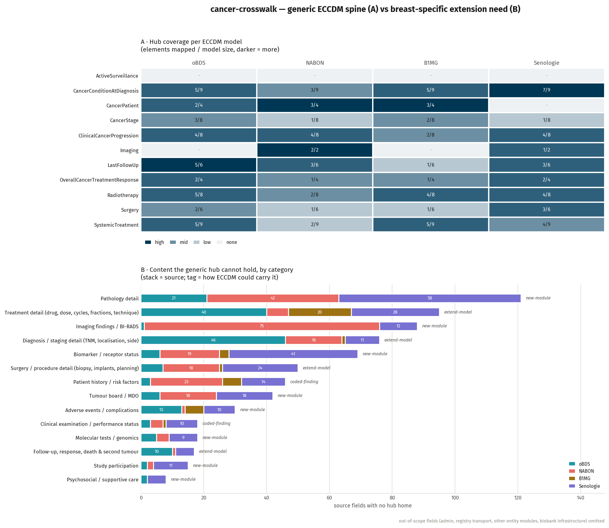
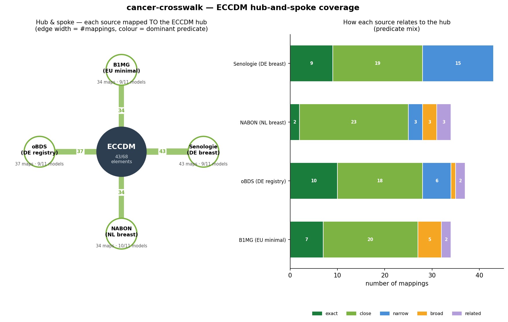

## Executive summary

We compared four cancer datasets against the **HL7 Europe Cancer Common Data
Model (ECCDM)** to answer one question: *if ECCDM is the shared hub, how much of
each dataset does it actually carry, and what is missing?*

Three results stand out:

1. ECCDM covers the **generic cancer backbone well** (63 % of its own elements
   are reached by at least one source) but only **8–24 % of each source
   dataset** — most fields have no hub home.
2. The uncovered fields are overwhelmingly **breast-cancer-specific detail**
   (ER/PR/HER2, BI-RADS, grading detail, molecular tests). ECCDM, being a
   pan-cancer *minimal* model, has no place for them.
3. That missing content is not random: it clusters into a small set of candidate
   **extension modules**, most of which are *data-dictionary* work (coded
   observations + value sets), not new structural modelling.

**Bottom line for a breast-cancer effort:** ECCDM works as a generic *semantic
spine*, but needs breast extension modules attached by evidence-reference. This
report quantifies exactly what those modules must contain.

---

## 1. Why this analysis

European cancer data lives in many national and domain standards. For registries
and EHDS secondary use, they need to be comparable. ECCDM is HL7 Europe's attempt
at a common denominator. Before adopting it as an exchange or aggregation target
— especially for a **breast-cancer** use case — we need to know empirically what
it can and cannot represent. This crosswalk provides that evidence.

It is an **analysis, not an Implementation Guide**: the output is a set of
machine-readable correspondence statements and the gaps that fall out of them.

## 2. What is being compared

**The hub** — ECCDM: 68 data elements across 11 logical models (CancerPatient,
CancerConditionAtDiagnosis, CancerStage, Surgery, Radiotherapy,
SystemicTreatment, ClinicalCancerProgression, LastFollowUp, …), extracted from
the IG's source.

**The spokes** — four source datasets:

| spoke | jurisdiction / scope | elements | source of truth |
|---|---|---|---|
| oBDS | DE · pan-cancer registry | 422 | official XSD 3.0.5 |
| NABON | NL · breast | 314 | ART-DECOR export |
| B1MG | EU · pan-cancer *minimal* | 140 | 1+MG-MDC (Zenodo) |
| Senologie | DE · breast (certified centres) | 299 | logical model (FSH) |

## 3. Method — how to read a mapping

**Hub-and-spoke.** Every source is mapped *to* ECCDM (the hub), never to each
other. This keeps the work at *n* mapping sets instead of *n×n*, and makes the
hub the reference for comparison.

**SSSOM** (Simple Standard for Sharing Ontological Mappings) is the format: each
mapping is a row `source element — predicate — hub element`, with a confidence
and a justification. We validate every set with the official `sssom` toolkit.

> **Key terms**
> - **predicate** — how the source element relates to the hub element:
>   `exactMatch` (same), `closeMatch` (near), `narrowMatch` (**source is finer**),
>   `broadMatch` (**source is coarser**), `relatedMatch` (weak).
> - **hub coverage** — of ECCDM's 68 elements, how many a source reaches.
> - **source coverage** — of a source's fields, how many reach the hub.
> - **carriage** — for an unmapped source field, *how* ECCDM could carry it:
>   `by-reference` (as a referenced observation), `new-module` (needs a new hub
>   model), or `out-of-scope`.

## 4. How to read the figures

**Figure 1 (overview)** has two panels.
*Panel A* — hub coverage per model: rows are ECCDM's 11 models, columns the four
sources; each cell shows *elements mapped / model size*, darker = higher
coverage. This is the "how much of the generic hub is filled" view.
*Panel B* — the extension modules: the breast-specific fields that have **no** hub
home, grouped and sized by how many fields, coloured by carriage. This is the
"what the hub is missing" view.

{ width=100% }

**Figure 2 (hub-spoke)** summarises each source's relationship to the hub: the
left radial shows how many mappings each source contributes; the right bars show
each source's **predicate mix** — this is where the granularity story is visible
(blue = narrower, orange = broader).

{ width=95% }

## 5. Findings

**F1 — The hub backbone is covered; the datasets are not.** 43 of 68 hub
elements (63 %) are reached by ≥1 source. But source coverage is 8 % (oBDS), 9 %
(NABON), 13 % (Senologie), 24 % (B1MG): the large majority of every dataset has
no ECCDM element to map to.

**F2 — Granularity asymmetry (Figure 2, right).** Specialised breast datasets
(Senologie, NABON) map mostly *narrower* than the hub — they are finer than the
pan-cancer model. The minimal dataset (B1MG) maps *broader* — it is coarser. The
registry (oBDS) sits closest to the hub. A common/minimal model is, by
construction, less granular than a specialised one.

**F3 — Breast specificity is invisible to a hub-indexed view.** ER/PR/HER2,
BI-RADS, Nottingham grading detail, sentinel nodes, molecular tests have no hub
field. Concretely, **0 of 13** oBDS breast-module fields are mappable to ECCDM.

**F4 — The gap is structured (Figure 1B).** Of ~1,000 unmapped source fields, the
clinically meaningful clusters are: Pathology detail (117), Biomarkers /
receptor status (53), Imaging findings / BI-RADS (44), tumour board / MDO (40),
molecular tests (26). Most are **by-reference** (coded observations); only MDO
needs a genuinely **new module**.

**F5 — Calculated values are unmarked.** UICC stage, Gleason score and overall
assessments are *derived* from other fields, not collected. ECCDM has no
`derivedFrom`/provenance axis to distinguish them — a further hub limitation.

## 6. What ECCDM would need — extension modules

The missing content maps onto a short wishlist, ordered by effort:

| module | carriage | nature |
|---|---|---|
| Biomarker / receptor status (ER/PR/HER2, Ki-67, PD-L1) | by-reference | data dictionary (Observations + value sets) |
| Pathology detail (margins, sentinel nodes, invasive/DCIS) | by-reference | data dictionary |
| Imaging findings / BI-RADS | by-reference | data dictionary |
| Molecular tests (Oncotype, MammaPrint) | by-reference | data dictionary |
| Calculated values (UICC, Gleason) | — | computable **Library** + provenance |
| Tumour board / MDO | new-module | one **new structural model** |

The key point: this is **mostly catalogue work** (coded data elements and value
sets attached to the generic spine by evidence-reference), plus a little
computable logic, plus one new model — not a redesign of ECCDM.

## 7. Recommendation

Adopt ECCDM as the **generic semantic spine**, and define breast-cancer
**extension modules** that attach to it by evidence-reference. Prioritise the
data-dictionary modules (biomarkers, pathology, imaging) since they are the
largest gap and the cheapest to build. Raise with the HL7 EU working group: (a)
a generic evidence/detail reference + an Observation/Finding logical model to
attach findings to, and (b) a `derivedFrom` axis for calculated values.

## 8. Status, limitations & reproducibility

- **All 148 mappings are `proposed` — no domain-expert review yet.** Confidences
  and predicates are first-pass.
- **Terminology (code-level) mapping is deferred**; this is the element/structural
  layer only.
- ~564 unmapped fields remain unclustered (triage pending) and are excluded from
  Figure 1B.
- **Reproducible**: `scripts/extract_*` rebuild each vocabulary from its official
  source; `coverage.py`, `heatmap.py`, `hubspoke.py`, `overview.py`,
  `inverse_gaps.py` regenerate every number and figure in this report. Mapping
  sets are plain SSSOM TSV and validate with the `sssom` toolkit.

*Repository: local git (`cancer-crosswalk`), 15+ commits, no remote yet.*
